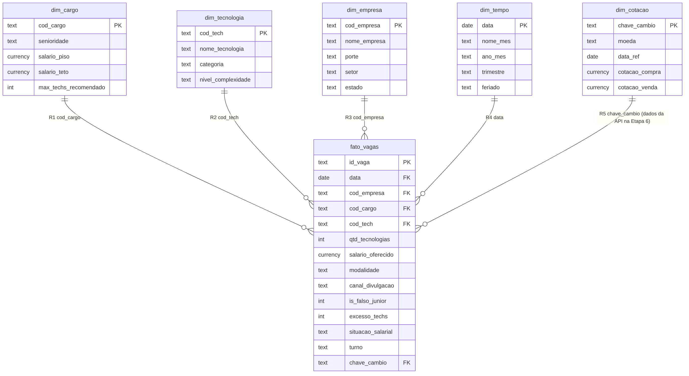

# Modelo do Power BI (Etapa V)

Fonte única: `02-bancodedados-sql/recrutamento.db` (Etapa IV), via ODBC (DSN `recrutamento`, parâmetro `pConexaoODBC`). Modo Importar. **Nenhum dado é digitado ou corrigido no Power BI**: uma correção é feita na etapa de origem e propagada com **Atualizar**.

## Tabelas (6 + `_Medidas`)
| Tabela no Power BI | Origem no banco | Papel | Linhas |
|---|---|---|---|
| `dim_cargo` | view `dim_cargo` | dimensão: senioridade, faixa salarial, teto de tecnologias | 4 |
| `dim_tecnologia` | view `dim_tecnologia` | dimensão: tecnologia principal da vaga | 15 |
| `dim_empresa` | view `dim_empresa` | dimensão: empresa, porte, setor, estado | 15 |
| `dim_tempo` | view `dim_tempo` | calendário (tabela de datas), 01/01 a 30/06/2026 | 181 |
| `fato_vagas` | view `fato_vagas` + `chave_cambio` (M) | fato: uma vaga | 16 |
| `dim_cotacao` | tabela `cotacao_dia` (moeda `pMoeda`) + `chave_cambio` (M) | fator externo (API AwesomeAPI, Etapa 6) | **0 até a API** |
| `_Medidas` | tabela vazia | guarda as medidas DAX, sem relacionamento | – |

Linhas rejeitadas na Etapa 2 **não** entram no painel (ficam em `vaga_rejeitada`/C6 no banco).

## Relacionamentos (N:1, direção única, todos ativos)
| Id | De (N, fato) | Para (1, dimensão) | Observação |
|---|---|---|---|
| R1 | `fato_vagas[cod_cargo]` | `dim_cargo[cod_cargo]` | |
| R2 | `fato_vagas[cod_tech]` | `dim_tecnologia[cod_tech]` | tecnologia **principal** da vaga |
| R3 | `fato_vagas[cod_empresa]` | `dim_empresa[cod_empresa]` | |
| R4 | `fato_vagas[data]` | `dim_tempo[data]` | `dim_tempo` marcada como tabela de datas |
| R5 | `fato_vagas[chave_cambio]` | `dim_cotacao[chave_cambio]` | chave `aaaa-mm-dd`; dados só depois da Etapa 6 |

`dim_cotacao` **não** se liga a `dim_tempo[data]` (criaria dois caminhos até a fato e uma relação inativa). A cotação acompanha os filtros do painel pela medida `[Cotação Média]` (`TREATAS`), no mesmo padrão da temperatura do guia (Seção 5.8). `pMoeda` (padrão `USD`; pode ser `EUR`) mantém uma linha por data em `dim_cotacao`, requisito do lado 1 de R5.

## Ajustes no modelo
- Desligar a detecção automática de relacionamentos e a data/hora automática (nenhuma `LocalDateTable_...` deve aparecer).
- `dim_tempo[nome_mes]` → classificar por `mes`; `nome_dia` por `dia_semana`; `dim_cargo[senioridade]` por `max_techs_recomendado`.
- Hierarquia **Calendário** em `dim_tempo`: `trimestre` > `nome_mes` > `data`.
- Ocultar: chaves (`cod_*`, `chave_cambio`), `fato_vagas[flag_falso_junior]`, `[is_falso_junior]`, `[max_techs_recomendado]`, `dim_tempo[ano]`, `[mes]`.
- Formatos: salários em R$; `Taxa Falso Júnior` e `Cresc. MoM %` em `0,0%`; médias em `0,00`; cotação com 4 casas.

## Correspondência de nomes: Etapa III → banco → Power BI
| Etapa III (Power Pivot) | Banco (Etapa IV) | Power BI |
|---|---|---|
| `fVagas` | `fato_vagas` (tabela `vaga`) | `fato_vagas` |
| `dCargo` | `dim_cargo` (tabela `cargo`) | `dim_cargo` |
| `dTecnologia` | `dim_tecnologia` (tabela `tecnologia`) | `dim_tecnologia` |
| `dEmpresa` | `dim_empresa` (tabela `empresa`) | `dim_empresa` |
| `dCalendario` | `dim_tempo` (tabela `calendario`) | `dim_tempo` |
| (reservado) | `cotacao_dia` | `dim_cotacao` |
| `Total de Vagas` | – | `[Total de Vagas]` |
| `Ticket Salarial Médio` | – | `[Salário Médio]` |
| `Média de Tecnologias Exigidas` | – | `[Média Techs]` |
| `Salário Médio Júnior` / `Média Techs Júnior` | – | `[Salário Médio Júnior]` / `[Média Techs Júnior]` |
| `Vagas Falso Júnior` | `is_falso_junior` | `[Vagas Falso Júnior]` |
| `Taxa de Requisitos Inflacionados` | C3 / K4 | `[Taxa Falso Júnior]` |
| `Salário por Tecnologia Exigida` | – | `[Salário por Tecnologia]` |

Regra do projeto: **Falso Júnior = `Cod_Cargo = CARG-JR` e `Qtd_Tecnologias > 3`**. A medida usa a regra explícita; `[Conf FJ Regra x Flag]` prova que bate com `is_falso_junior`, calculada pelo banco.

> Correção em relação à Etapa III: lá as medidas "Júnior" usavam `RELATED()` dentro do filtro do `CALCULATE`, que não funciona como filtro. Aqui o filtro é aplicado direto em `dim_cargo[senioridade]`/`[cod_cargo]`.

## Pontos de atenção sobre os dados
1. **Divergência com a Etapa 3** (registrada em `02-bancodedados-sql/README.md`): painel da Etapa 3 = 11 vagas Júnior, 4,54 techs, R$ 5.736,36, 54,5%; banco e este painel = **12, 4,33, R$ 5.766,67, 50,0%**. A equipe precisa decidir qual número vai para o relatório final.
2. **Valor atípico:** VAG-016 (Júnior, 8 tecnologias, **R$ 25.000**, Glassdoor). Sem ela, a média dos Júnior cai de R$ 5.766,67 para R$ 4.018,18 e a dos Falso Júnior de R$ 7.316,67 para R$ 3.780,00. O painel traz também o **salário mediano** Júnior (R$ 4.150,00). A vaga não é removida.
3. Base pequena (16 vagas): proporções por canal ou por mês têm poucas vagas e **não permitem concluir tendência**.
4. **Câmbio:** `cotacao_dia` está vazia. Nenhuma conclusão sobre salário × câmbio pode ser escrita no relatório antes de a API carregar dados reais; a página 3 mostra aviso e fica em branco.
